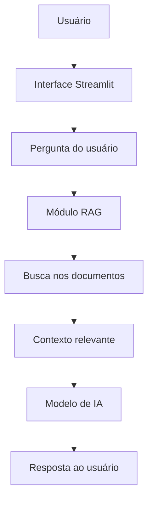

# Assistente Virtual de Secretaria Acadêmica com RAG

Projeto acadêmico desenvolvido como MVP para aplicar IA generativa no ciclo de desenvolvimento de software.

## Objetivo

Criar um assistente virtual capaz de responder dúvidas acadêmicas utilizando documentos da secretaria como base de conhecimento.

## Arquitetura do Projeto

O projeto seguirá uma arquitetura simples, adequada a um MVP:



```markdown
## Fluxo de funcionamento

1. O usuário envia uma pergunta pela interface.
2. O módulo RAG busca informações relevantes nos documentos da secretaria.
3. O conteúdo recuperado é enviado como contexto para o modelo de IA.
4. O modelo gera uma resposta baseada nas informações encontradas.
5. A resposta é exibida ao usuário.
