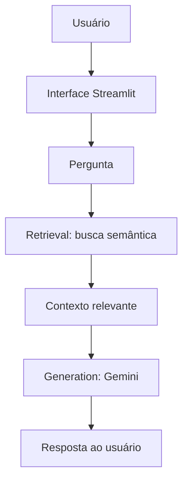

# Assistente Virtual de Secretaria Acadêmica com RAG

Projeto acadêmico (MVP) que aplica um pipeline RAG (**Retrieval + Generation**) para responder dúvidas sobre regras acadêmicas a partir de `documentos/regulamento_academico.txt`.

## Como funciona



1. O usuário envia uma pergunta pela interface.
2. O Retrieval busca, por similaridade (sentence-transformers), a seção mais relevante do regulamento.
3. O contexto recuperado é enviado ao modelo Gemini, que gera a resposta.
4. A resposta é exibida ao usuário.

## Como executar

1. Instale as dependências:
   ```bash
   pip install -r requirements.txt
   ```
2. Defina a variável de ambiente com sua chave gratuita do Google Gemini:
   ```powershell
   $env:GEMINI_API_KEY = "sua-chave-aqui"
   ```
   Obtenha a chave em https://aistudio.google.com/apikey (plano gratuito, sem cartão).
3. Rode o app:
   ```bash
   streamlit run app.py
   ```

## Testes

```bash
pytest
```

## Uso de IA generativa no desenvolvimento

- A IA generativa (assistentes de código) foi usada como apoio no desenvolvimento deste projeto: revisão da estrutura, correção do chunking dos documentos e sugestões de código.
- No produto final, a IA generativa (Google Gemini) é usada na etapa de **Generation** do RAG.
