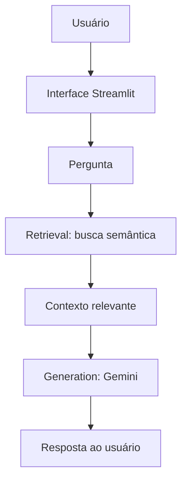

# Assistente Virtual de Secretaria Acadêmica com RAG

Projeto acadêmico (MVP) que aplica um pipeline RAG (**Retrieval + Generation**) para responder dúvidas sobre regras acadêmicas a partir de `documentos/regulamento_academico.txt`.

## Objetivo

Desenvolver um MVP de assistente virtual para uma secretaria acadêmica utilizando RAG (Retrieval-Augmented Generation), combinando busca semântica em documentos com geração de respostas por IA.

O objetivo do projeto é demonstrar, de forma simples e didática, como uma aplicação pode recuperar informações de uma base de conhecimento específica e utilizá-las como contexto para gerar respostas mais confiáveis.

## Como funciona



1. O usuário envia uma pergunta pela interface.
2. O Retrieval busca, por similaridade (sentence-transformers), a seção mais relevante do regulamento.
3. O contexto recuperado é enviado ao modelo Gemini, que gera a resposta.
4. A resposta é exibida ao usuário.

## Como executar

1. Crie e ative um ambiente virtual:

   ```bash
   python -m venv .venv
```

No Windows:

```bash
.venv\Scripts\activate
```

2. Instale as dependências:

```bash
pip install -r requirements.txt
```

3. Defina a variável de ambiente com sua chave gratuita do Google Gemini:

```powershell
$env:GEMINI_API_KEY = "sua-chave-aqui"
```

A chave pode ser criada no Google AI Studio.

4. Rode o aplicativo:

```bash
streamlit run app.py
```


## Testes

```bash
python -m pytest
```

## Uso de IA generativa no desenvolvimento

- A IA generativa (assistentes de código) foi usada como apoio no desenvolvimento deste projeto: revisão da estrutura, correção do chunking dos documentos e sugestões de código.
- No produto final, a IA generativa (Google Gemini) é usada na etapa de **Generation** do RAG.

## Tecnologias utilizadas

- Python 3.12
- Streamlit
- Sentence Transformers
- Google Gemini API
- Pytest
- Git e GitHub

### Modelos de IA

- `sentence-transformers/all-MiniLM-L6-v2` para geração de embeddings e busca semântica.
- `gemini-3.8-flash` para geração das respostas.

### Assistentes de IA utilizados no desenvolvimento

- ChatGPT: apoio no planejamento, definição do escopo, arquitetura e entendimento das etapas.
- OpenCode com Big Pickle: revisão de código, identificação e correção de problemas, geração de testes e apoio à documentação.

## Exemplos de uso

Perguntas que podem ser realizadas ao assistente:

- Qual é a frequência mínima para aprovação?
- Quanto posso faltar nas aulas?
- Quais documentos são necessários para trancar a matrícula?
- Qual é o prazo para solicitar segunda chamada?
- Como solicitar declaração de matrícula?

Caso a informação não esteja disponível na base de conhecimento, o assistente é orientado a informar que não encontrou a informação no contexto fornecido.

## Limitações e Próximos Passos

### Limitações

- A base de conhecimento contém apenas um regulamento acadêmico fictício e de pequeno porte.
- O sistema realiza a recuperação da seção mais relevante da base.
- A geração da resposta depende de conexão com a internet e disponibilidade da API do Google Gemini.
- O projeto não possui autenticação, persistência de histórico ou painel administrativo.

### Próximos Passos

Como evolução futura, o projeto poderia:

- utilizar múltiplos documentos acadêmicos;
- exibir a fonte utilizada na geração da resposta;
- melhorar o tratamento de indisponibilidade da API;
- adicionar histórico de conversas;
- ampliar os testes automatizados.

## Créditos e Licença

Projeto desenvolvido para fins acadêmicos como parte de um laboratório de aplicação de Inteligência Artificial Generativa no desenvolvimento de software.

Este projeto é destinado a fins educacionais.